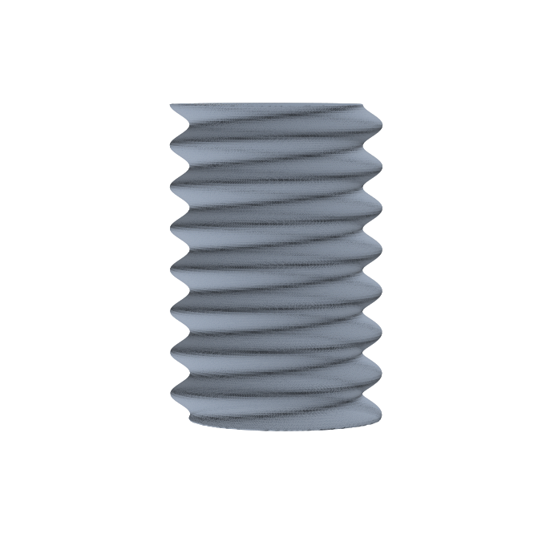
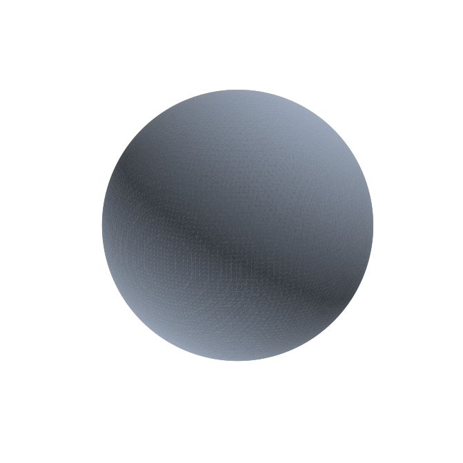
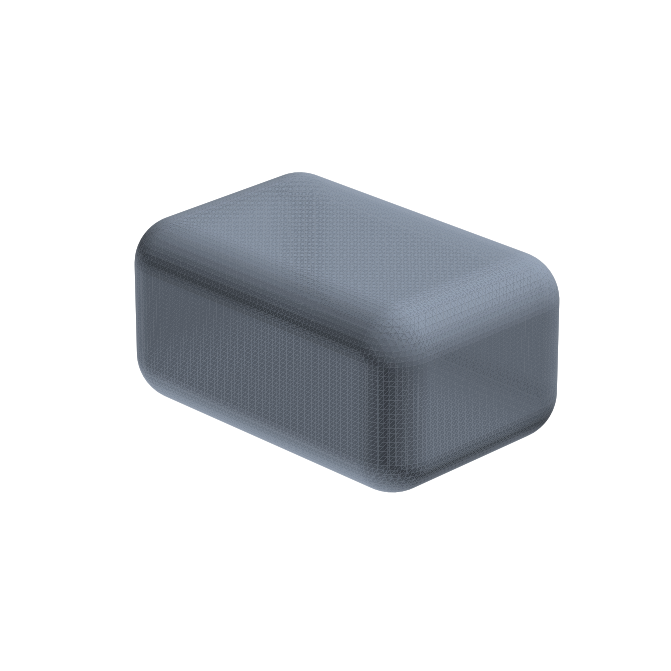
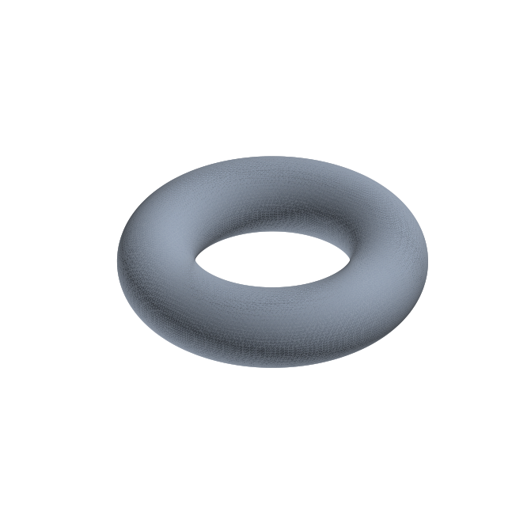
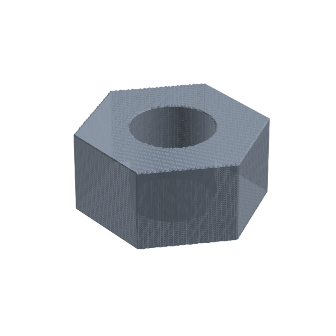
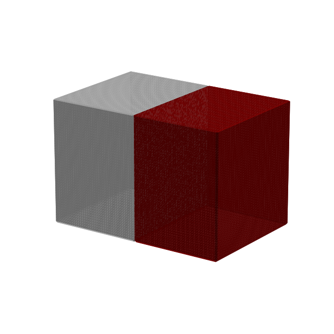

# xyzcadrs — functional/implicit CAD in Rust

[](https://github.com/TheTesla/xyzcadrs/actions/workflows/ci.yml)
[](LICENSE)

A Rust port of [xyzcad](https://github.com/TheTesla/xyzcad) — an easy-to-use
CAD system that turns a **function of space** into a watertight,
3D-printable mesh.

Describe your part as a plain Rust function `f(x, y, z) -> material`
(`0` = air, `1..=255` = material id) and the renderer produces the
isosurface mesh: a flood fill walks the whole surface, a 256-entry
marching-cubes lookup table polygonises it, and every cut point is refined
onto the exact surface by bisection. No JIT warm-up, no build-time code
generation — the field is just a closure.



## Features

- **Fields as closures** — boolean or multi-material; booleans, SDFs,
  CSG-by-hand (intersection/subtraction in the function body), helical
  threads, anything expressible as `fn([f64; 3]) -> u8`.
- **Watertight STL export** — binary STL with computed facet normals.
  The test suite verifies watertightness, analytic volume (sphere: within
  0.1 %) and bounding boxes for every example.
- **Multi-material OBJ export** — one `usemtl` group per material id and a
  companion MTL file with per-material colors (using the standard `Kd`
  statement — the Python original emitted the non-standard `Kb`, which most
  viewers ignore).
- **Behaviour parity with the Python original** — the raster semantics,
  corner conventions, lookup table and repair mechanism are ported 1:1 and
  pinned by tests against reference counters measured on the original.
- **Fast** — ~4–5× faster than the warm numba renderer, and ~200× faster
  than a cold start (no compilation step). Cut-point refinement and
  per-material meshing are parallelised with rayon.
- **Built-in mesh validation** — STL reader + watertightness/volume/bbox
  statistics, exposed as `xyzcadrs validate <file>`.

## Quick start

### As a library

```rust
use xyzcadrs::render_and_save;

fn main() {
    // A solid sphere of radius 10 mm.
    let ball = |p: [f64; 3]| {
        if 100.0 > p[0] * p[0] + p[1] * p[1] + p[2] * p[2] { 1 } else { 0 }
    };

    render_and_save(&ball, "sphere.stl", 0.3).unwrap();
}
```

`render_and_save` picks the export format from the file extension:
`*.stl` writes a binary STL, `*.obj` writes a triangulated OBJ + MTL pair.
It returns the render summary (cube/point/edge/polygon counters) and prints
progress lines like the original.

### As a CLI

```console
$ cargo install --path .          # or: cargo build --release
$ xyzcadrs list                   # built-in example fields
$ xyzcadrs render torus --res 0.3 -o torus.stl
$ xyzcadrs render split-box --res 0.4 -o split_box.obj
$ xyzcadrs validate sphere.stl
file                 sphere.stl
triangles            41816
vertices (welded)    20910
degenerate triangles 0
watertight           true
volume                4186.951 mm3
bbox x               -9.998 .. 9.998
...
```

## Examples

All examples live in `examples/` and render in well under a second
(`cargo run --release --example <name>`).

### Sphere — the canonical xyzcad example

```rust
let sphere = |p: [f64; 3]| {
    if 100.0 > p[0] * p[0] + p[1] * p[1] + p[2] * p[2] { 1 } else { 0 }
};
```



### Rounded box — signed distance field with edge rounding

```rust
// |p| box distance with 3 mm rounding: q = |p| - half + r,
// d = length(max(q, 0)) + min(max(qx, qy, qz), 0) - r
```



### Torus

```rust
let d = (12.0 - (p[0] * p[0] + p[1] * p[1]).sqrt()).powi(2) + p[2] * p[2];
let inside = d < 4.0 * 4.0;
```



### Threaded rod — a true helical sine thread

The crest radius oscillates with the helix phase `z/pitch - theta/(2*pi)`,
the same construction as fuzzyometry's `fz_thread`:

```rust
let theta = p[1].atan2(p[0]);
let phase = 2.0 * PI * (z / 2.5 - theta / (2.0 * PI));
let inside = radial < 5.8 + 0.6 * phase.sin();
```


### Hex nut — boolean composition

Hexagonal prism (16 mm across flats) minus an 8 mm bore, written directly
into the field function:

```rust
let hex = ax <= 8.0 && ay <= 8.0 && az <= 8.0;   // three axis pairs at 60°
let nut = thick && hex && radial >= 4.0;
```



### Two materials — colored OBJ

A box split into material 1 (x < 0) and material 2 (x ≥ 0). Each material
becomes one OBJ group with its own MTL color:



## Bindings

The renderer is not limited to Rust — a C ABI layer
([`c-api/`](c-api/)) makes it available from many languages:

- **Python with numba `njit` fields** — write fields exactly like in the
  original xyzcad; the compiled machine code is called directly by the Rust
  renderer (no GIL, no per-point overhead). ~4x faster than the warm numba
  renderer, with no renderer JIT at all. See [`docs/BINDINGS.md`](docs/BINDINGS.md).
- **C** — plain `libxyzcadrs_c` with a function-pointer field API
  ([`c-api/include/xyzcadrs.h`](c-api/include/xyzcadrs.h)).
- **C++** — RAII header with `std::function` fields
  ([`c-api/include/xyzcadrs.hpp`](c-api/include/xyzcadrs.hpp)).
- **Cython** — Python-callable trampoline or zero-overhead `cdef` fields
  ([`bindings/cython/`](bindings/cython/)).
- **Go** — cgo binding with an exported trampoline
  ([`bindings/go/`](bindings/go/)).

Every binding is covered by parity tests against the Python original —
details, build instructions and benchmark numbers in
[`docs/BINDINGS.md`](docs/BINDINGS.md).

## How it works

1. **Seed search** — probe a hierarchically refined grid over
   `[-1000, 1000]³` until two points with different field values are found,
   then converge onto the surface with the original's chaotic-bisection
   walk.
2. **Flood fill** — walk from the seed cube across all faces that carry
   differing corner values, collecting the 8 corner values of every visited
   raster cube (edge length = resolution). Corner values of the entered
   face are reused instead of re-evaluating the field.
3. **Meshing** — deduplicate raster points and edges, find all edges cut by
   the surface (endpoints with different values), refine each cut point
   onto the exact isosurface (24-step bisection, parallelised), and
   polygonise every cube from the triangle lookup table indexed by its
   8-bit corner mask.
4. **Repair** — boundary loops (directed edges whose reversal is missing)
   are chained and closed with extra polygons.
5. **Export** — fan triangulation per polygon; binary STL (all materials
   merged) or grouped, colored OBJ + MTL.

Details, conventions and the parity verification method are documented in
[docs/ALGORITHM.md](docs/ALGORITHM.md).

## Differences from the Python original

| Aspect | xyzcad (Python) | xyzcadrs (Rust) |
| --- | --- | --- |
| Field definition | `numba`-jitted function, 4-tuple input, int-cast return | plain closure `Fn([f64; 3]) -> u8`, no JIT |
| Cold start | ~24 s per new field (numba compilation) | none |
| Warm render speed | baseline | ~4–5× faster (sphere r=10, res 0.3: 0.43 s → 0.11 s) |
| Point values | derived from cube corners (point-reflected corner, nets out to the field value) | field evaluated directly at the point (equivalent output, see docs) |
| OBJ MTL diffuse | `Kb` (non-standard, ignored by most viewers) | `Kd` |
| Empty-field seed search | scans the full hierarchical grid (hangs) | same scan, capped by an evaluation budget (error instead of hang) |
| Determinism | Python set/dict iteration order leaks into repair loops and vertex order | fully deterministic output |
| Repair on degenerate fields | loop decomposition depends on set order | same algorithm, deterministic start order |

Everything else — raster quantization, corner/mask/edge conventions, the
lookup table, single-connected-surface limitation, material group
semantics — is ported exactly and pinned by parity tests.

## Performance

Measured on a 16-thread i7 Alder Lake laptop, sphere r = 10 mm, total wall
time including STL writing:

| Resolution | Python (warm numba) | xyzcadrs (release binary) | Speed-up |
| --- | --- | --- | --- |
| 0.3 mm | 0.423 s | 0.106 s | 4.0× |
| 0.15 mm | 1.942 s | 0.427 s | 4.5× |

The first Python run additionally pays ~24 s of numba compilation per new
field function; the Rust binary has no compilation step at run time.

## Testing

```console
$ cargo test
```

- **Unit tests** — grid quantization, seed search, corner-value semantics,
  lookup-table invariants, color table, triangulation.
- **Parity tests** — five field/resolution combinations pinned against
  counters measured on the Python original, plus a per-cut-edge usage
  invariant (every cut edge is used by exactly 4 cube polygons).
- **Integration tests** — every example is rendered, re-read from disk and
  checked for watertightness, degenerate facets, analytic volume (sphere
  within 0.1 %, torus within 0.2 %, hex nut within 0.2 %) and bounding box.

## Limitations

- **One connected surface per render** — the flood fill walks a single
  surface; disjoint solids render only the first one found (inherited from
  the original, see docs).
- The raster lattice is anchored at the seed, so cube counts vary slightly
  with the seed position (same as the original).
- Fields whose origin lies in air trigger a deep seed scan (millions of
  evaluations) before material is found — identical to the original, but
  bounded by the evaluation budget in the Rust version.
- Degenerate geometry (thin slits, tangential contacts) can produce
  non-manifold corners; the repair stage closes the boundary loops, but
  heavily degenerate fields may keep defects — same failure mode as the
  original.

## License

AGPL-3.0-or-later, matching the original xyzcad. See [LICENSE](LICENSE).
